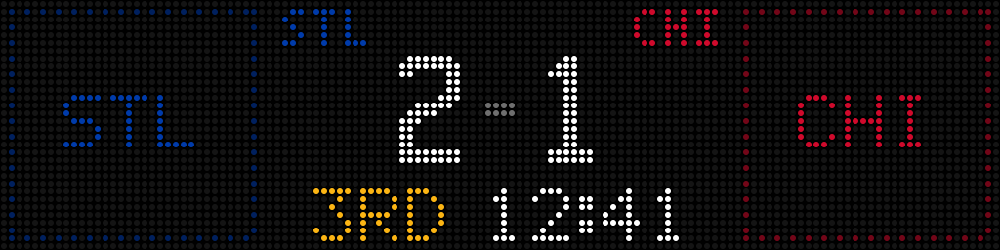

# NHL LED Scoreboard

A pixel-accurate NHL scoreboard for a 128×32 RGB LED matrix (two 64×32 HUB75
panels), built to run first as a browser simulator on an iPad and later on a
Raspberry Pi 4 driving the real panels.



*Headless render of the real 128×32 framebuffer. Logos appear as dotted
placeholders here, because NHL logos are not stored in this repository. In the
app they load from the NHL's own servers.*

## What it does

- **A real 128×32 framebuffer.** Every digit, letter, logo and animation is drawn
  into a `width × height × 3` RGB buffer. The simulator then shows each LED as a
  dot with nearest-neighbour scaling. Nothing is drawn at high resolution and
  filtered afterwards.
- **LED simulator** with adjustable brightness, pixel spacing, round or square
  LEDs, optional glow (added after the frame is rendered) and a panel-seam overlay.
- **Resolution comparison**: 128×32 (2 panels, the default), 192×32 (3 panels)
  and 128×64 (2 taller panels). Changing resolution re-runs the layouts. It does
  not stretch the old image.
- **Layouts**: A Classic, B Large score, C Matchup (with start time and
  countdown), D Final (FINAL, FINAL/OT, FINAL/SO), E Around the NHL (rotation),
  F Blues priority, G Goal celebration.
- **Live NHL data** from the public NHL web API (`api-web.nhle.com`). It polls
  every 30 s while games are live and every 5 min otherwise. It has timeouts,
  retry backoff and caching, and on failure it shows the last known data marked
  STALE. It never invents scores.
- **Goal detection** that ignores app restarts, recovery from stale data and
  repeated refreshes.
- **Official team logos** for all 32 clubs, reduced to LED size. The logo gallery
  compares 4 resizing methods side by side, and you can choose a different method
  for each team.
- **Demo mode**: Blues 2 – 1 Blackhawks, 3rd period, 12:41. You can add goals, run
  the clock, change period, start an intermission, end the game, celebrate and
  reset.
- **Diagnostics and export**: framebuffer size, data source, last update,
  errors, and the exact frame as a PNG (1:1 or 8×) or raw RGB bytes.

## Open it on your iPad

### Option 1: GitHub Pages (no computer needed after setup)

1. On github.com open this repository → **Settings → Pages**. Under *Build and
   deployment → Source* choose **GitHub Actions**. You only do this once.
2. Open the **Actions** tab. The workflow *Test, build & deploy to GitHub Pages*
   runs on every push. If it ran before Pages was enabled, click it and choose
   **Re-run all jobs**.
3. When it is green, the site is at
   **`https://timbosche-sudo.github.io/nhl-led-scoreboard/`**.
4. In Safari tap **Share → Add to Home Screen** to get a full-screen app icon.

Demo mode works straight away. Live data and logos also need the free proxy
described below, because the NHL API blocks requests from other websites (CORS).

### Option 2: Run it on a computer on your home Wi-Fi

```bash
npm install
npm run dev            # prints a "Network:" URL, e.g. http://192.168.1.20:5173
```

Open that Network URL in Safari on the iPad. The development server proxies the
NHL API itself, so live data and logos work without the Cloudflare step.

To test the production build in the same way the Pi will serve it:

```bash
npm run build && npm run serve      # http://<computer-ip>:8080
```

## Live data on GitHub Pages: the Cloudflare Worker proxy

GitHub Pages can only host static files. The NHL API does not send the CORS
headers browsers require, so Safari can't read it from a Pages site. The fix is
a tiny, free proxy. It needs no API keys and holds no secrets.

1. Create a free account at <https://dash.cloudflare.com>.
2. Go to **Workers & Pages → Create → Create Worker**, name it e.g. `nhl-proxy`,
   then click **Deploy**.
3. Click **Edit code**, replace everything with the contents of
   [`proxy/cloudflare-worker.js`](proxy/cloudflare-worker.js), then click **Deploy**.
4. Copy the worker URL, e.g. `https://nhl-proxy.yourname.workers.dev`. Opening
   it in a browser should show `{"ok":true,...}`.
5. Give the URL to the app in one of two ways:
   - **Per device:** in the app go to **Display → NHL proxy URL**, paste it and
     tap **Save**.
   - **Built in:** in GitHub go to **Settings → Secrets and variables → Actions →
     Variables**, add `NHL_PROXY_URL` = the worker URL, and re-run the workflow.

The worker forwards only read-only NHL score, schedule and logo paths, so it
can't be used as an open proxy. To restrict it to your site, set the Worker
variable `ALLOWED_ORIGIN=https://timbosche-sudo.github.io`.

## Using the app

| Tab | What's there |
| --- | --- |
| **Scoreboard** | Demo or live data; Blues priority, Around the NHL or one game; favourite team; layout; rotation and interval; which goals to celebrate; *Test goal animation*. In Demo mode this tab also has the demo controls. |
| **Games** | Today's games with scores and status, plus upcoming games. Tap one to put it on the board. |
| **Logos** | All 32 logos at real LED resolution, a resize-method comparison, per-team overrides, *Preview on main display*, and where each logo was loaded from. |
| **Display** | Resolution, brightness, spacing, glow, LED shape, panel seams, default logo resizing, time zone (America/Chicago by default), refresh intervals, proxy URL. |
| **Diagnostics** | Mode, framebuffer size, data source, connection, last successful update, API errors, and frame export. |

The badge at the top right always shows whether the board is on **DEMO DATA**
or **LIVE NHL DATA**, and turns red (**LIVE · STALE**) when data couldn't be
refreshed. In demo mode the LED bezel also gets an amber outline.

### Demo mode

Pick **Scoreboard → Data → Demo**. The demo game (St. Louis Blues at Chicago
Blackhawks, 2–1, 3rd, 12:41) is generated entirely in the browser and labelled
DEMO everywhere. A Blues goal goes through the same goal-detection path as live
data, so it triggers the celebration. Blackhawks goals update the score without
a celebration unless *All goals* is selected. An overtime goal ends the game
(FINAL/OT).

### How game states are handled

| NHL `gameState` / `gameScheduleState` | Board shows |
| --- | --- |
| `FUT` | Matchup with local start time and countdown |
| `PRE` | Matchup, PREGAME |
| `LIVE` / `CRIT` | Score, period and clock (e.g. `3RD 12:41`, `OT 3:12`, `SO`) |
| live with `clock.inIntermission` | `2ND INT 14:22` |
| clock at 0:00 before the API flags intermission | `END 1ST` |
| `FINAL` / `OFF` | `FINAL`, `FINAL/OT`, `FINAL/2OT`, `FINAL/SO` |
| `PPD` / `SUSP` / `CNCL` | `PPD` / `SUSP` / `CNCL` |

The "hockey day" rolls over at 5 AM local time, so late games and their finals
stay on the board after midnight.

## NHL API

The app uses the community-documented public endpoints behind nhl.com:

- `GET https://api-web.nhle.com/v1/score/{YYYY-MM-DD}`: the day's games, live
  scores, clock and period.
- `GET https://api-web.nhle.com/v1/schedule/{YYYY-MM-DD}`: the week ahead, for
  upcoming games.
- Logos: `https://assets.nhle.com/logos/nhl/svg/{TEAM}_dark.svg`

These endpoints are unofficial and can change, so the parser
(`src/nhl/parse.ts`) treats every field as optional and is tested against a real
captured schedule payload (`src/nhl/__fixtures__`). No API key is needed.

## Development

```bash
npm install
npm run dev          # simulator with hot reload (also reachable from the iPad)
npm test             # unit, layout-bounds, API, demo, goal and proxy tests
npm run typecheck
npm run build        # production build to dist/
npm run serve        # serve dist/ + NHL proxy on :8080 (Pi-style server)
npm run render       # headless render of every layout to docs/frames/ (no browser)
npm run fetch-logos  # cache official logos locally in public/logos/nhl/ (git-ignored)
```

### Project layout

```
src/
  core/        framebuffer, colours, bitmap fonts, text, logo resizing, PNG encoder   (no DOM)
  nhl/         API client (timeouts, retries, endpoint fallback), parser, status, time zones, poller
  teams/       the 32 clubs and their colours
  logos/       logo cache + LED fitting                                             (no DOM)
  layouts/     layouts A–D, messages, logo showcase                                 (no DOM)
  animation/   goal detection and goal celebration                                  (no DOM)
  scheduler/   Blues priority / Around the NHL / single-game selection              (no DOM)
  demo/        demo game simulator                                                  (no DOM)
  engine/      ScoreboardEngine: picks the game and layout, runs animations, renders a frame
  hardware/    FrameSink interface + frame wire format for the future Pi driver
  config/      settings, defaults and validation
  ui/          React app, LED canvas simulator, SVG logo loader (the only DOM code)
server/        zero-dependency Node server: static app + NHL proxy (local and Pi)
proxy/         Cloudflare Worker proxy for GitHub Pages
scripts/       headless frame renderer, logo cache script
docs/          framebuffer spec, Raspberry Pi plan, logo sources, rendered frames
```

The tests render every layout × game state × logo shape × resolution and check
that no pixel is written outside the panel and that no two elements overlap.

## Raspberry Pi (next phase)

See [docs/RASPBERRY_PI.md](docs/RASPBERRY_PI.md) for the researched plan:
Pi 4 + Adafruit RGB Matrix Bonnet + hzeller's `rpi-rgb-led-matrix`. The same
TypeScript engine would run headless in Node and pipe RGB frames to a small
matrix bridge, with the web app served from the Pi as the iPad control panel.
[docs/FRAMEBUFFER_SPEC.md](docs/FRAMEBUFFER_SPEC.md) defines the shared byte
format. **None of the hardware path has been tested yet.**

## Notes

Unofficial fan project. It is not affiliated with or endorsed by the NHL. NHL
and team names and logos are trademarks of the NHL and its teams. Logos are
loaded from the NHL's servers at runtime and are not redistributed here (see
[docs/LOGOS.md](docs/LOGOS.md)).
